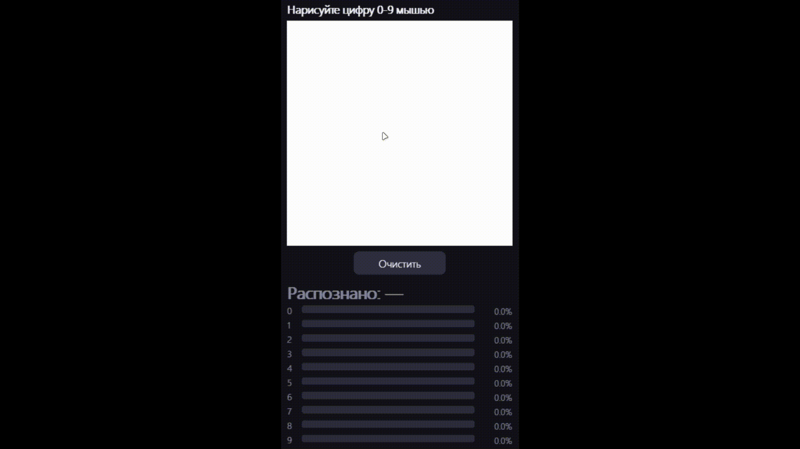
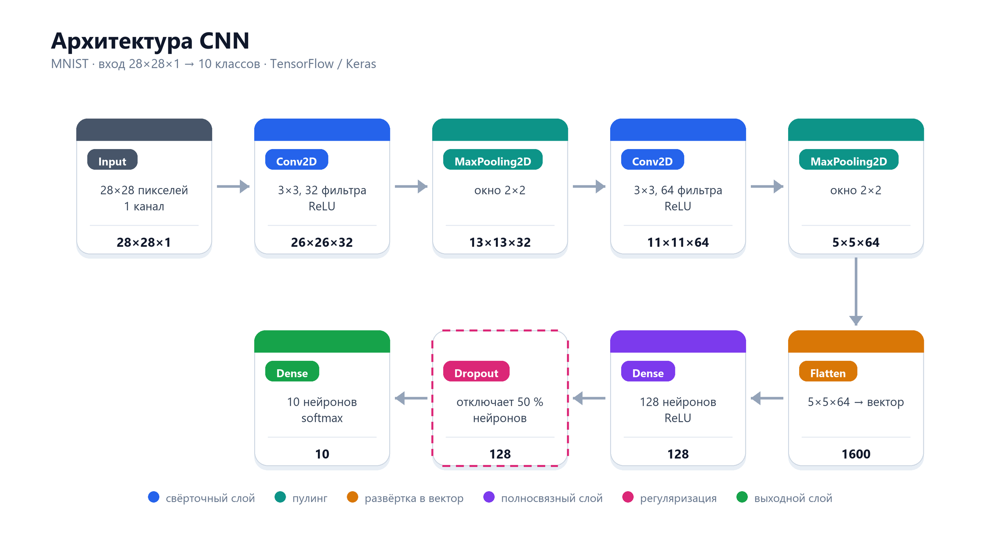

<h1 align="center">Digit-Recognizer</h1>



## О проекте

Приложение для распознавания рукописных цифр (0–9) в реальном времени.
Рисуешь цифру мышью на холсте 28×28 — нейросеть тут же показывает
вероятности для каждой цифры и выделяет самую уверенную.
Пересчёт идёт на лету, примерно 10 раз в секунду, пока ты ведёшь мышью.

## Технологии

- **Python** — язык разработки
- **Pygame** — интерфейс и обработка рисования мышью
- **TensorFlow / Keras** — нейросеть (CNN)
- **MNIST** — датасет для обучения модели
- **NumPy** — работа с массивами пикселей
- **Pillow** — обработка изображений

## Архитектура нейросети

В основе — свёрточная сеть (CNN) для классификации изображений 28×28.
Размерности входа и выхода жёстко зашиты в `model_manager.py`
(`INPUT_SHAPE = (28, 28, 1)`, `OUTPUT_SHAPE = (10,)`): любая загруженная
модель проверяется на соответствие им.



Схема ниже — это архитектура из `train_cnn()`, то есть та сеть, которую
приложение обучает само, если готовый файл модели скачать не удалось.
Внешний вход и выход у скачанных моделей ровно такие же (проверка в
`_load_and_validate`), а вот внутренние слои в чужом файле могут быть
другими.

По слоям это выглядит так:

- **Входной слой** — один: тензор **28×28×1**, то есть 784 значения
  в диапазоне 0…1 (чёрные чернила — единица, белая бумага — ноль).
- **Скрытые слои** — восемь:
  - свёрточный `Conv2D`: 32 фильтра 3×3, активация **ReLU** → 26×26×32;
  - `MaxPooling2D` с окном 2×2 → 13×13×32;
  - свёрточный `Conv2D`: 64 фильтра 3×3, активация **ReLU** → 11×11×64;
  - `MaxPooling2D` с окном 2×2 → 5×5×64;
  - `Flatten` — развёртка карт признаков в вектор из 1600 чисел;
  - полносвязный `Dense` на 128 нейронов, активация **ReLU**;
  - `Dropout` с вероятностью 0.5 — случайно гасит половину нейронов,
    работает только при обучении.
- **Выходной слой** — один: `Dense` на **10 нейронов** с активацией
  **softmax**. На выходе получается вектор вероятностей, который
  в сумме даёт единицу, — его и рисует интерфейс в виде полосок.

Весов не имеют пулинги, развёртка и dropout, поэтому обучаемых слоёв
с параметрами всего четыре: два свёрточных и два полносвязных.

| № | Слой | Настройки | Активация | Выход | Параметров |
|---|------|-----------|-----------|-------|-----------:|
| 1 | `Conv2D` | 32 фильтра 3×3 | ReLU | 26×26×32 | 320 |
| 2 | `MaxPooling2D` | окно 2×2 | — | 13×13×32 | 0 |
| 3 | `Conv2D` | 64 фильтра 3×3 | ReLU | 11×11×64 | 18 496 |
| 4 | `MaxPooling2D` | окно 2×2 | — | 5×5×64 | 0 |
| 5 | `Flatten` | — | — | 1600 | 0 |
| 6 | `Dense` | 128 нейронов | ReLU | 128 | 204 928 |
| 7 | `Dropout` | p = 0.5 | — | 128 | 0 |
| 8 | `Dense` | 10 нейронов (выход) | softmax | 10 | 1 290 |

Итого **225 034** обучаемых параметра — это около 0,9 МБ весов в float32.
Основная их масса (204 928) сидит в полносвязном слое после развёртки,
поэтому модель и остаётся такой лёгкой: свёрточная часть отвечает
за поиск штрихов и петель, а «тяжёлая» часть — за само решение.

## Данные

Сеть обучается на **MNIST** — стандартном датасете рукописных цифр,
который Keras скачивает сам (`keras.datasets.mnist.load_data()`):

- **60 000** изображений в обучающей выборке и **10 000** в тестовой;
- каждое изображение — 28×28 пикселей в градациях серого, ровно один символ;
- 10 классов (цифры 0–9), распределение классов примерно равномерное;
- в исходном MNIST цифра уже обрезана по границам и вписана в поле 20×20
  по центру, а пиксели хранятся как целые 0…255 на чёрном фоне.

Перед подачей в сеть данные приводятся к тому же виду, что и при обучении:
`uint8` переводится в `float32` и делится на 255, затем добавляется
размерность канала — получается батч `(N, 28, 28, 1)`.

Отдельная работа идёт на стороне приложения, в `preprocessing.py`:
нарисованное мышью изображение уменьшается до 28×28, инвертируется
по полярности (чёрные чернила → 1.0, белая бумага → 0.0), обрезается
по bounding box, вписывается в поле 20×20 и центрируется по центру масс
за три итерации. Без этих шагов нарисованная толстой кистью цифра
не похожа на MNIST — и точность на живом рисовании проседает.

## Вкратце об обучении

Обучение — в функции `train_cnn()` в `model_manager.py`, запускается
автоматически, если готовую модель не удалось скачать:

- оптимизатор **Adam** со стандартным шагом;
- функция потерь — **sparse categorical crossentropy** (метки — целые
  числа, без one-hot);
- **3 эпохи**, размер батча **64**, аугментаций и learning rate schedule нет;
- на CPU это занимает около 20 секунд, так что модель можно переобучить
  при каждом запуске с нуля;
- лучшие (а точнее — последние) веса сохраняются в `models/mnist_cnn.keras`.

Динамика по эпохам (валидация — тестовая выборка, поэтому последняя строка
и есть итоговая точность):

| Эпоха | Loss (train) | Accuracy (train) | Loss (val) | Accuracy (val) |
|:-----:|-------------:|-----------------:|-----------:|---------------:|
| 1 | 0.245 | 92,54 % | 0.048 | 98,44 % |
| 2 | 0.088 | 97,52 % | 0.040 | 98,75 % |
| 3 | 0.066 | 98,07 % | 0.032 | 98,83 % |

Видно, что уже первой эпохи хватает на 98 %: задача простая, а разрыв
между train и val — следствие dropout 0.5, который «мешает» сети
на обучении. Дальше точность растёт медленно, и добавление эпох
даёт доли процента — на глаз это уже не заметно.

## Метрики

Замеры для эталонной архитектуры из `train_cnn()` на тестовой выборке
MNIST (10 000 изображений, цифры ни разу не встречались при обучении):

| Метрика | Значение |
|---|---|
| Accuracy на тесте | **98,83 %** |
| Loss на тесте | 0.032 |
| Ошибок из 10 000 | ≈ 117 |
| Обучаемых параметров | 225 034 |
| Размер сохранённой модели | ≈ 2,7 МБ (вместе с состоянием оптимизатора) |
| Время одного предсказания | ≈ 3 мс (CPU, батч из одного изображения) |
| Частота пересчёта в интерфейсе | 10 раз в секунду |

Про скорость: в `model_manager.predict()` модель вызывается напрямую,
без обёртки `model.predict()` — на такой маленькой сети обёртка тратит
около 40 мс на пересборку итератора подачи данных, а прямой вызов
укладывается в единицы миллисекунд.

Слабое место ожидаемо то же, что у любой MNIST-модели: единица и семёрка,
четвёрка и девятка, а также цифры, нарисованные с непривычным наклоном
или слишком тонкой линией. Частично это лечится предобработкой —
центрированием и приведением к 20×20.

## Как запустить

1. Клонируй репозиторий:

```bash
git clone https://github.com/andreyvol2005/Digit-Recognizer.git
cd Digit-Recognizer
```

2. Установи зависимости (нужен Python 3.10–3.12, TensorFlow 2.19):

```bash
pip install -r requirements.txt
```

3. Запусти приложение:

```bash
python main.py
```

При первом запуске модель скачается или обучится автоматически —
это может занять пару минут. Дальше запуск будет мгновенным:
готовая модель лежит в `models/mnist_cnn.keras` и просто загружается.

## Управление

- **Левая кнопка мыши** — рисовать цифру;
- **Очистить** или клавиша **C** — стереть холст;
- **Esc** — выход.

## Структура проекта

```
Digit-Recognizer/
├── main.py            # окно Pygame, холст, отрисовка вероятностей
├── model_manager.py   # загрузка/скачивание/обучение модели, предсказание
├── preprocessing.py   # холст → тензор 28×28 в формате MNIST
├── requirements.txt
├── recognizer.gif     # демонстрация
├── architecture.png   # схема нейросети
└── models/            # создаётся при первом запуске
    └── mnist_cnn.keras
```
