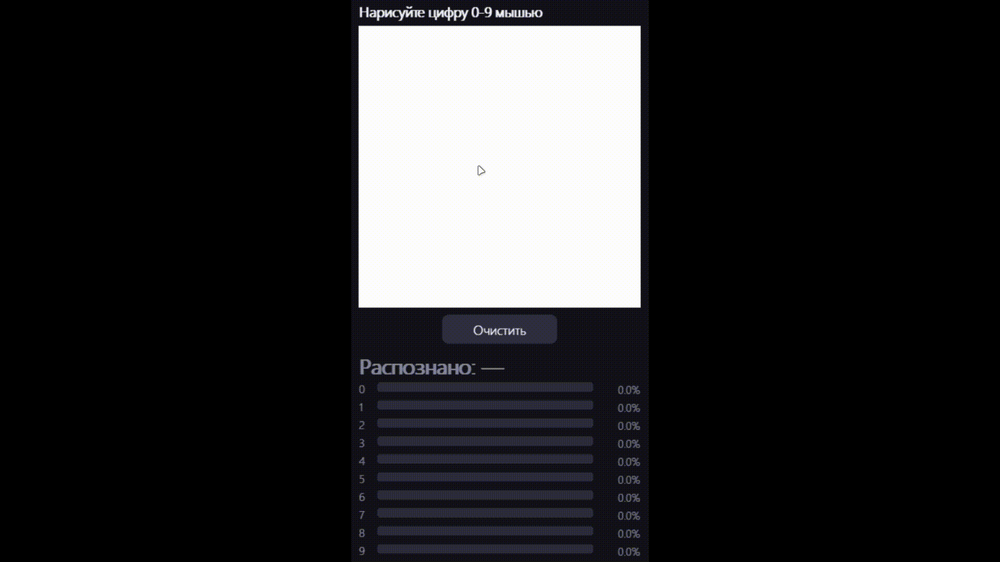

# Digit Painter



## О проекте

Приложение для распознавания рукописных цифр (0–9) в реальном времени.
Рисуешь цифру мышью на поле 28×28 — нейросеть тут же показывает
вероятности для каждой цифры и выделяет самую уверенную.

## Технологии

- **Python** — язык разработки
- **Pygame** — интерфейс и обработка рисования мышью
- **TensorFlow / Keras** — нейросеть (CNN)
- **MNIST** — датасет для обучения модели
- **NumPy** — работа с массивами пикселей
- **Pillow** — обработка изображений

## Как запустить

1. Клонируй репозиторий:

```bash
git clone https://github.com/твой-username/digit-painter.git
cd digit-painter
```

2. Установи зависимости:

```bash
pip install -r requirements.txt
```

3. Запусти приложение:

```bash
python main.py
```

При первом запуске модель скачается или обучится автоматически —
это может занять пару минут. Дальше запуск будет мгновенным.
